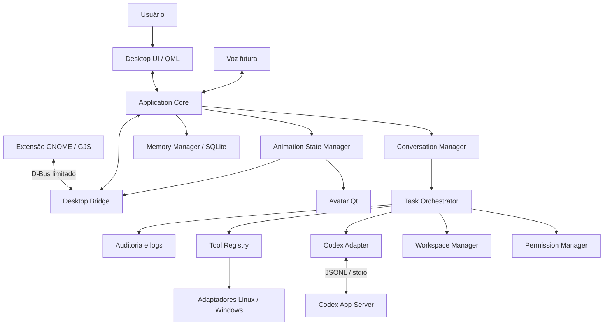

# Arquitetura do Quill

Especificação v1 — 2026-11-11. Estado: desenho aprovado para documentação; nenhum componente de runtime implementado. Consulte [TASKS.md](TASKS.md) para progresso real.

## Objetivos e limites

Assistente local com mascote, conversa, programação pelo Codex e ferramentas de desktop consentidas. MVP em Manjaro GNOME/Wayland e Windows 11 x86_64, com testes nativos nos dois. Outros desktops Linux usam capacidades detectadas; macOS é posterior. “Portátil” não significa suportar todo compositor ou sistema sem adaptações.

O núcleo é um monólito modular Python. UI, orquestração e armazenamento pertencem ao aplicativo; Codex, comandos e voz são subprocessos supervisionados. Não introduzir serviços em rede. Conteúdo autorizado enviado ao Codex pode chegar ao provedor; local refere-se ao aplicativo e ao controle das ferramentas.

## Decisões e alternativas

| Área | Decisão | Alternativas e motivo |
|---|---|---|
| Python | 3.13.x, uv, src layout | Não depender do Python rolling do Manjaro; patch resolve no lock da fase |
| Interface | PySide6 6.12.x, Qt Quick/QML, Fusion customizado | PyQt6 não traz benefício para este projeto; Widgets dificulta composição animada |
| Animação | PNG RGBA + manifesto JSON | Rive acrescenta runtime e não unifica integração Qt/GNOME; vídeo/GIF dificulta estados |
| Execução Codex | App Server stdio | exec JSONL é documentado para uso pontual, não substitui aprovações interativas |
| Persistência | sqlite3 + SQL versionado | ORM e banco vetorial sem necessidade do MVP |
| Desktop GNOME | GJS desenha avatar; Python desenha painel | Flags de janela Qt não garantem posição/above no Wayland |
| Desktop Windows | Qt + Win32 por ctypes | Não injetar código no Explorer nem depender de WSL |
| Ferramentas | Registro Python e propostas estruturadas | Sem shell livre decidido pelo modelo; MCP dinâmico experimental não é requisito |
| Concorrência | Qt main thread + asyncio worker | Evitar event loops concorrentes na mesma thread e dependência qasync |
| Programação | Snapshot independente + revisão | Não modificar diretamente projeto sujo nem compartilhar .git com o agente |

Dependências runtime entram progressivamente: platformdirs (Q002), PySide6 (Q009), jsonschema (Q010), psutil (Q027), Playwright (Q038). pytest/ruff/mypy entram Q001; pytest-qt entra Q009. sqlite3, TOML de leitura, dataclasses e logging são stdlib. Q002 escreve apenas o subconjunto TOML suportado (escalares, listas de strings e tabelas fixas), com serializador testado por roundtrip tomllib; não preservar comentários de configuração gerada pelo app. Nenhuma execução usa eval.

Voz externa opcional, sem runtime de ML no ambiente Python principal. Não adicionar watchdog: sem necessidade de monitoramento contínuo de árvores no MVP.

## Diagrama



## Responsabilidades e fluxo

| Módulo | Responsabilidade | Proibido |
|---|---|---|
| Application Core/bootstrap | Compor dependências, lifecycle, serviços e shutdown | Regras de produto espalhadas no QML |
| UI | Viewmodels, conversa, permissões, revisão, logs | I/O bloqueante, shell ou autorização implícita |
| Avatar Engine | Validar/carregar assets e apresentar frames | Conhecer ferramentas, credenciais ou código do projeto |
| Animation State Manager | Priorizar estados com relógio injetável | Decidir sucesso de tarefa |
| Conversation Manager | Validar entrada, projeto e intenção; persistir mensagens | Interpretar resposta do modelo como autorização |
| Task Orchestrator | Fila, estados, execução, verificação e recuperação | Reexecutar efeito desconhecido automaticamente |
| Codex Integration | Protocolo externo e normalização de eventos | Alterar política sem aprovação |
| Tool Registry | Schemas, resolução da ferramenta e limites | Importação/execução arbitrária por nome recebido |
| Permission Manager | Grants, aprovações e avaliação determinística | Delegar decisão de segurança ao modelo |
| Memory Manager | Migrações, transações e consultas paginadas | Chave secreta no SQLite |
| Logging/Observability | Eventos redigidos e correlação | Prompts completos e tokens nos logs operacionais |
| Configuration Manager | Defaults, versão e escrita atômica | Alterar config global do Codex |
| Voice Services | Captura, STT/TTS canceláveis, opcional | Capturar microfone por padrão |
| Platform adapters | Capabilities, janelas, apps, notificações e processos | Anunciar capacidades não testadas |

Fluxo: entrada → validação e task UUID → persistir queued → avaliar escopo → snapshot/proposta de ferramenta → política → executar → persistir eventos/progresso → verificar resultados independentes → revisão → aprovação de changeset → revalidar hashes → aplicar com journal → finalizar. Em modo leitura, concluir sem changeset. Em tarefa desktop, pular snapshot quando a ferramenta não executa código de projeto; validação de recursos e permissões continua obrigatória.

## Threads e lifecycle

Main thread possui QApplication, QML, QtDBus e viewmodels. Um ExecutionWorker possui thread própria e event loop asyncio; bootstrap usa sinais queued para intenções e respostas. O worker não toca QML/QObject da main thread. QtDBus recebe na main thread e encaminha DTOs sem I/O demorado.

Persistência possui uma thread dedicada com uma conexão SQLite. Chamadas retornam Future adaptada ao loop. Trabalho de arquivos usa executor de até duas threads; cancelamento cooperativo checado entre arquivos. Não cancelar uma aplicação de diff a meio de uma escrita sem concluir journal/recuperação.

UI recebe batch de deltas a cada 50 ms. Buffer de progresso até 256 eventos não terminais; coalescer somente deltas, nunca decisões/erros/conclusões. Cada consumidor usa execução+sequência para descartar duplicados.

Instância única: bootstrap usa QLockFile em data e QLocalServer com nome derivado do usuário; segunda abertura pede à primeira que mostre o painel e termina. Não remover lock vivo; --version/--help não inicializam lock ou dados. Isso impede filas independentes concorrentes do mesmo usuário.

Shutdown: negar novas entradas → cancelar tarefa → negar aprovações pendentes → encerrar Codex/filhos → persistir estado → drenar logs → fechar SQLite → parar worker → remover bridge/atores. UI pode ocultar janela, mas “Sair” encerra explicitamente serviços. Não depender de tray para reabrir: launcher e indicador GNOME são alternativas.

## Estrutura e propriedade dos arquivos

```text
src/quill/
  __init__.py, __main__.py, bootstrap.py
  core/{models,ports,errors,events}.py
  config/{models,service}.py
  observability/{logging,redaction}.py
  memory/store.py, memory/migrations/001_initial.sql
  conversation/service.py
  tasks/{orchestrator,recovery,process_supervisor}.py
  permissions/{models,policy,service}.py
  workspaces/{snapshot,manifest,changes,apply,journal}.py
  codex/{capabilities,sandbox,transport,protocol,executor,session,approvals}.py
  tools/{registry,planner,system,processes,files,applications,logs,terminal,browser}.py
  platforms/base.py
  platforms/linux/{applications,desktop}.py
  platforms/windows/{sandbox,desktop,window,jobs,applications}.py
  platforms/generic/desktop.py
  desktop/{bridge,notifications,autostart}.py
  avatar/{assets,state}.py
  ui/{bridge,models}.py, ui/qml/
  voice/{capture,stt,tts,playback,activation}.py
assets/avatars/quill/
extensions/gnome/quill@quill.local/
schemas/{codex,avatar.schema.json,tool-plan.schema.json,desktop-bridge.xml}
tests/{unit,integration,ui,security,fixtures}/
packaging/{linux,windows}/
```

ui/bridge.py é a fachada de intenções QML para o worker; desktop/bridge.py é exclusivamente o transporte D-Bus da extensão. platforms/linux/desktop.py adapta GNOME/portais e fallback Qt, sem executar GJS no Python. src/quill/core é independente de PySide6 e ferramentas externas.

## Tipos e contratos canônicos

Todos os modelos abaixo são dataclasses frozen/slots em core/models.py, exceto modelos de política em permissions/models.py. Nomes técnicos em inglês. Path nunca vira caminho vindo do modelo sem validação. JsonValue = None | bool | int | float | str | list[JsonValue] | dict[str, JsonValue]; rejeitar NaN/Infinity. Horários UTC aware; limites de duração usam monotonic. Erros nunca transportam exceção ou token bruto.

| Tipo | Campos obrigatórios (campos opcionais indicados com ?) |
|---|---|
| ExecutorCapabilities | cli_version:str, schema_digest:str, authenticated:bool, available_models:tuple[ModelCapability,...], sandbox:SandboxCapabilities, supported_methods:frozenset[str] |
| ModelCapability | id:str, display_name:str, efforts:tuple[str,...] |
| SandboxCapabilities | available:bool, restricted_read:bool, bounded_write:bool, command_network_block:bool, backend:str, reason:str? |
| ExecutionRequest | task_id:UUID, execution_id:UUID, workspace_id:UUID?, cwd:Path, prompt:str, mode:PermissionMode, model:str, effort:str, thread_id:str?, deadline_utc:datetime |
| ExecutionEvent | id:UUID, execution_id:UUID, sequence:int, occurred_at:datetime, kind:EventKind, payload:dict[str,JsonValue] |
| ActionRequest | id:UUID, task_id:UUID, tool_name:str, arguments:dict[str,JsonValue], resources:tuple[ResourceRef,...], risk:Risk, effect:Effect, scope_id:UUID? |
| ResourceRef | kind:ResourceKind, canonical_value:str, fingerprint:str? |
| PermissionDecision | outcome:DecisionOutcome, reason:str, grant_id:UUID?, approval_id:UUID? |
| ToolSpec | name:str, schema_version:int, input_schema:dict[str,JsonValue], output_schema:dict[str,JsonValue], risk:Risk, effect:Effect, timeout_s:int |
| ToolRequest | id:UUID, task_id:UUID, name:str, arguments:dict[str,JsonValue] |
| ToolContext | mode:PermissionMode, granted_resources:tuple[ResourceRef,...], deadline_utc:datetime, execution_id:UUID, workspace_id:UUID? |
| ToolResult | request_id:UUID, success:bool, output:dict[str,JsonValue], error:ErrorInfo?, observed_effects:tuple[ResourceRef,...] |
| SnapshotRequest | task_id:UUID, source:Path, selected_untracked:tuple[Path,...], scope_id:UUID |
| WorkspaceSnapshot | id:UUID, task_id:UUID, source:Path, root:Path, files:tuple[FileFingerprint,...], excluded:tuple[ExcludedFile,...], created_at:datetime |
| FileFingerprint | relative_path:str, sha256:str, size:int, executable:bool |
| ExcludedFile | relative_path:str, reason:str |
| ChangeSet | id:UUID, workspace_id:UUID, files:tuple[FileChange,...], diff_artifact:Path, digest:str, verification:tuple[VerificationEvidence,...] |
| FileChange | relative_path:str, kind:ChangeKind, before_sha256:str?, after_sha256:str?, binary:bool, executable_before:bool?, executable_after:bool? |
| VerificationEvidence | argv:tuple[str,...], cwd:Path, exit_code:int?, started_at:datetime, finished_at:datetime, result:str, artifact:Path? |
| ApplyResult | changeset_id:UUID, status:ApplyStatus, applied:tuple[str,...], restored:tuple[str,...], conflicts:tuple[str,...], journal_id:UUID |
| DesktopCapabilities | backend:str, absolute_position:bool, topmost:bool, notifications:bool, global_shortcuts:bool, gui_automation:bool, limitations:tuple[str,...] |
| Notification | id:UUID, title:str, body:str, task_id:UUID?, urgency:str |
| LaunchResult | application_id:str, accepted:bool, process_id:int?, error:ErrorInfo? |
| DomainEvent | id:UUID, aggregate_id:UUID, sequence:int, kind:EventKind, occurred_at:datetime, payload:dict[str,JsonValue] |
| TaskRecord | id:UUID, conversation_id:UUID, submission_id:UUID, state:TaskState, mode:PermissionMode, project:Path?, created_at:datetime, updated_at:datetime, error:ErrorInfo? |
| TaskQuery | limit:int=50, cursor:str?, state:TaskState? |
| Page[T] | items:tuple[T,...], next_cursor:str? |
| ErrorInfo | code:ErrorCode, message:str, retryable:bool, safe_details:dict[str,JsonValue] |

Enums: PermissionMode={read,assisted,restricted_auto}; DecisionOutcome={allow,deny,pending}; Risk={low,medium,high}; Effect={read,create,modify,move,launch,execute,external}; ResourceKind={path,application,command,network}; ChangeKind={added,modified,deleted}; ApplyStatus={applied,conflict,rolled_back,recovery_required}. TaskState e EventKind seguem a seção de estados. Modelo de avatar tem contrato separado em AVATAR_DESIGN.md.

Interfaces em core/ports.py; imports desses DTOs são explícitos:

```python
class CodexExecutor(Protocol):
    async def inspect(self) -> ExecutorCapabilities: ...
    def run(self, request: ExecutionRequest) -> AsyncIterator[ExecutionEvent]: ...
    async def cancel(self, execution_id: UUID) -> None: ...

class PermissionService(Protocol):
    async def evaluate(self, action: ActionRequest) -> PermissionDecision: ...
    async def resolve(self, approval_id: UUID, approved: bool) -> None: ...

class Tool(Protocol):
    def describe(self) -> ToolSpec: ...
    async def execute(self, request: ToolRequest, context: ToolContext) -> ToolResult: ...

class WorkspaceService(Protocol):
    async def snapshot(self, request: SnapshotRequest) -> WorkspaceSnapshot: ...
    async def compare(self, workspace_id: UUID) -> ChangeSet: ...
    async def apply(self, changeset_id: UUID, approval_id: UUID) -> ApplyResult: ...

class DesktopAdapter(Protocol):
    def capabilities(self) -> DesktopCapabilities: ...
    async def open_application(self, application_id: str) -> LaunchResult: ...
    async def notify(self, notification: Notification) -> None: ...

class MemoryStore(Protocol):
    async def append_event(self, event: DomainEvent) -> None: ...
    async def save_task(self, task: TaskRecord) -> None: ...
    async def list_tasks(self, query: TaskQuery) -> Page[TaskRecord]: ...
```

Complementos internos: ConfigService.load()->AppConfig, save(config:AppConfig)->None; ConversationService.submit(conversation_id:UUID,text:str,project:Path|None,mode:PermissionMode,submission_id:UUID)->TaskRecord (async); TaskOrchestrator.submit(task:TaskRecord)->None e cancel(task_id:UUID)->None (async); ToolRegistry.get(name:str)->Tool; AvatarStateManager.on_event(event:DomainEvent)->AvatarPresentation. Clock.now_utc()->datetime e monotonic()->float são injetados; CancellationToken.cancelled:bool permite cancelamento entre operações. UI consome DTOs por bridge, sem chamar banco diretamente.

## Contratos mínimos das ferramentas desktop

Inputs e outputs v1 são objetos fechados, sem propriedades extras. IDs de raiz/arquivo/app vêm de seleção autorizada; payload do modelo nunca cadastra uma raiz. Paths apresentados são relativos à raiz autorizada. Null só é aceito onde indicado.

| Ferramenta | Input | Output |
|---|---|---|
| system.info | {} | os:str, release:str, architecture:str, cpu_count:int, memory_total_bytes:int, memory_available_bytes:int |
| processes.list | limit:int=50 (1–100), cursor:str? | items:[{pid:int,name:str,status:str,cpu_percent:float?,rss_bytes:int?}], next_cursor:str?, inaccessible_count:int |
| files.list | root_id:UUID, relative_path:str, cursor:str?, limit:int=50 (1–100) | entries:[{name:str,kind:file/directory, size_bytes:int?}], next_cursor:str? |
| files.mkdir | root_id:UUID, relative_path:str | relative_path:str, created:bool |
| files.move | root_id:UUID, source:str, destination:str | source:str, destination:str, moved:bool |
| applications.open | application_id:str | application_id:str, accepted:bool, process_id:int? |
| logs.read | file_id:UUID, offset:int>=0, limit:int=65536 (1–1048576) | text:str, next_offset:int, eof:bool, redacted:bool |
| terminal.run | argv:[str] não vazio, cwd_workspace_id:UUID, timeout_s:int=30 (1–120) | exit_code:int?, stdout:str, stderr:str, truncated:bool, cancelled:bool |

Todas são encapsuladas em ToolResult; falha usa success=false/ErrorInfo, não um “sucesso” com texto de erro. Contadores de memória em bytes; CPU em percentual de um núcleo com ausência representada por null. Pagination cursor é opaco; não interpretar cursor como path. argv/output do terminal tem teto de 1 MiB por stream e marcador truncated; output é redigido antes de persistir. files.mkdir retorna created=false sem mutação se já for diretório permitido; arquivo no mesmo nome é conflito. files.move é apenas dentro da mesma raiz/volume e sem overwrite.

## Estados e eventos

TaskState: queued, preparing, running, awaiting_approval, verifying, awaiting_review, applying, succeeded, failed, cancelled, interrupted, blocked. running pode alternar com awaiting_approval; verifying pode retornar a running no mesmo limite/deadline. verifying termina em succeeded sem mudanças ou awaiting_review com changeset. applying termina succeeded, failed ou blocked para recuperação. Estados terminais não voltam à fila sem nova submissão. Cancelar applying registra intenção, termina a operação atômica/journal e só então finaliza.

EventKind: task.queued, task.state_changed, execution.started, execution.progress, execution.output, approval.requested, approval.resolved, tool.completed, verification.completed, changeset.ready, application.completed, execution.completed, execution.failed, task.interrupted. Payloads incluem schema_version=1; sequências crescem por aggregate_id. Eventos externos desconhecidos não viram sucesso; preservar apenas metadados seguros.

## SQLite, configuração e dados

Uma conexão no worker: foreign_keys=ON, journal_mode=WAL, busy_timeout=5000. Migrações transacionais em ordem; backup antes de migração futura destrutiva; falha mantém versão anterior e impede startup de execução. Sem downgrade automático.

| Tabela | Colunas centrais e restrições |
|---|---|
| conversations | id PK, title, created_at, updated_at |
| messages | id PK, conversation_id FK, role CHECK user/assistant/tool/system, content, created_at, task_id FK nullable |
| tasks | id PK, conversation_id FK, submission_id UNIQUE, state CHECK, mode CHECK, project_path nullable, created_at, updated_at, error_json nullable |
| task_events | id PK, task_id FK, sequence, kind, payload_json, occurred_at; UNIQUE(task_id,sequence) |
| executions | id PK, task_id FK, backend, thread_id, turn_id, model, effort, cli_version, schema_digest, state, started_at, finished_at nullable |
| workspaces | id PK, task_id FK, source_path, root_path, created_at, status |
| workspace_files | workspace_id FK, relative_path, sha256, size, executable; PK(workspace_id,relative_path) |
| changesets | id PK, workspace_id FK, digest, manifest_json, diff_path, verification_json, status |
| permission_grants | id PK, mode, scope_json, arguments_digest nullable, expires_at, revoked_at nullable, quota_json |
| approval_requests | id PK, task_id FK, action_json, action_digest, state, requested_at, expires_at, resolved_at nullable |
| tool_runs | id PK, task_id FK, tool_name, action_digest, state, result_json nullable, started_at, finished_at nullable |
| settings | key PK, value_json, schema_version |
| schema_migrations | version PK, applied_at, checksum |

JSON é schema-versionado; parâmetros SQL nunca concatenados. Estado e evento da tarefa são persistidos na mesma transação via operação interna transition(task_id,expected_state,next_state,event), implementada em Q005. Public save_task não deve permitir contornar a transição compare-and-set. Índices: tasks(state,created_at,id), messages(conversation_id,created_at,id), executions(task_id), approval_requests(state,expires_at). Cursor de histórico é par created_at/id; limite 1–100.

TOML é canônico para configuração editável; settings armazena preferências de sessão/UI. Nunca duplicar autorização em TOML: grants pertencem ao banco. AppConfig v1: default_mode=read, theme(system/light/dark), avatar_size=160, avatar_visible=true, reduced_motion=false, task_timeout_s=1200, log_retention_days=14, history_retention_days=90, workspace_retention_days=7, voice_enabled=false, autostart=false, model_id nullable, reasoning_effort=low. Tipo/chave desconhecida gera erro com caminho, sem reset silencioso. Permissões padrão vazias.

platformdirs determina config/data/cache/log por sistema. SQLite e artefatos de execução ficam em data; snapshots em data/workspaces/<UUID>; diretórios privados no POSIX e ACL do usuário no Windows. Nunca armazenar dados de usuário dentro da instalação/repositório. Backups e journals ficam fora do workspace visível ao agente.

Logs: JSONL com timestamp, level, event, task_id, execution_id, code e mensagem redigida; 10 MiB × 5 arquivos. Histórico não deve conter tokens/credenciais; usuário pode apagar conversa/workspace explicitamente. Logs expiram 14 dias, histórico 90 e workspace concluído 7; mudanças não aplicadas bloqueiam limpeza automática. Expirar grants ao encerrar tarefa ou prazo, o que vier primeiro.

## Erros e limites

ErrorCode: CONFIG_INVALID, CODEX_NOT_FOUND, AUTH_REQUIRED, MODEL_UNAVAILABLE, PROTOCOL_INCOMPATIBLE, SANDBOX_UNAVAILABLE, PERMISSION_DENIED, APPROVAL_EXPIRED, TIMEOUT, CANCELLED, PROCESS_FAILED, WORKSPACE_CONFLICT, RECOVERY_REQUIRED, STORAGE_FULL, RESOURCE_LIMIT, VALIDATION_FAILED, INTERNAL_ERROR. Mensagem curta em português; detalhe técnico redigido no painel. Retryable é informativo e nunca autoriza repetir efeitos.

Uma tarefa ativa global, um turno ativo/thread, fila de até 20 pedidos; excesso rejeitado. Prompt até 32 KiB UTF-8; máximo 8 ciclos de ferramentas e 2 repetições idênticas sem progresso encerram blocked. Snapshot padrão até 20.000 arquivos/1 GiB; excedente bloqueia e exige escopo menor, sem cópia parcial silenciosa. Arquivos acima de 20 MiB são excluídos e relatados antes de executar; binários não exibem diff textual.

Inicialização 15 s; RPC controle 30 s; tarefa 20 min; aprovação 5 min. Cancelamento interrupt → 5 s → término → 3 s → kill. Linha de protocolo até 8 MiB. Supervisor impõe prazo; mecanismos nativos de RAM/CPU/processos detectados por capacidades, com indisponibilidade explícita. Não prometer quota universal que o SO não pode aplicar.

## Fontes e critérios de compatibilidade

Consultadas em 2026-11-11. Constatado localmente Codex 0.167.1; Q006 registra schema real antes de implementar. Versões de Python/Qt deste projeto são decisões de baseline, não medições de instalação.

- [Qt — janelas e Wayland](https://doc.qt.io/QT-6/application-windows.html): posicionamento depende do shell/compositor; flags não garantem a experiência.
- [Qt for Python — distribuição](https://doc.qt.io/qtforpython-6/deployment/index.html): builds e pacotes por plataforma.
- [Qt — AnimatedSprite](https://doc.qt.io/qt-6.12/qml-qtquick-animatedsprite.html): recurso de sprites usado no renderer Qt.
- [GJS — extensões](https://gjs.guide/extensions/development/creating.html): componente específico do GNOME, com lifecycle próprio.
- [Win32 — SetWindowPos](https://learn.microsoft.com/en-us/windows/win32/api/winuser/nf-winuser-setwindowpos): integração nativa de janela Windows.
- [Rive — runtimes](https://rive.app/docs/runtimes/getting-started): alternativa avaliada e adiada.

Riscos de segurança e recuperação são canônicos em [SECURITY.md](SECURITY.md). Testabilidade por fase está em [TESTING.md](TESTING.md).
